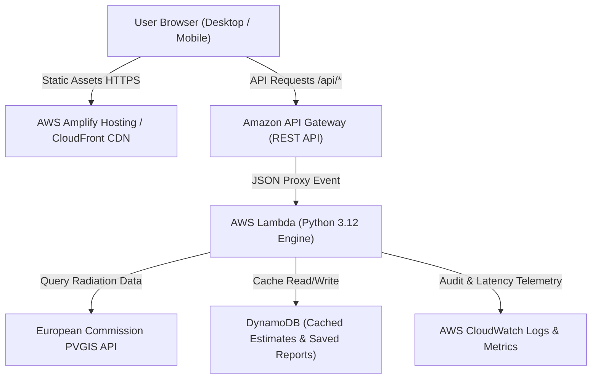
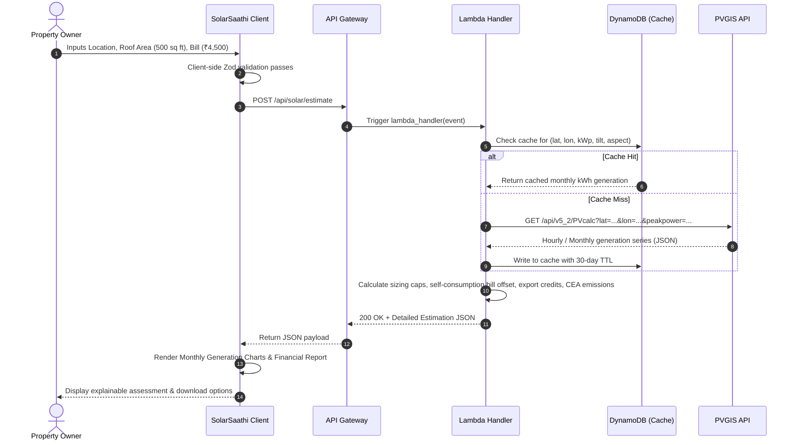

# SolarSaathi System Architecture

## 1. High-Level Architecture Overview

SolarSaathi is engineered as a cloud-native, decoupled web application. The frontend is a high-performance single-page application (SPA) designed with a clean design system, while the backend is an event-driven serverless architecture hosted on AWS.

---

## 2. Component Breakdown

### A. Frontend Layer
- **Framework & Tooling:** React 18 / TypeScript, Vite build tool.
- **Styling & Tokens:** Tailwind CSS utility classes aligned with custom CSS tokens (`--color-sage`, `--color-emerald-deep`, `--color-canvas`, etc.).
- **Component Primitives:** Accessible headless primitives (Radix UI / custom compliant primitives).
- **Iconography:** Lucide Icons (lightweight, vector SVG).
- **Data Visualization:** Recharts for monthly solar generation curves, seasonal irradiance comparisons, and cumulative cash-flow trajectories.
- **Form Management & Validation:** React Hook Form coupled with strict Zod schemas for input validation and error feedback.

### B. Backend API Layer
- **Runtime:** AWS Lambda (Python 3.12) with type hints, structured logging, and Pydantic schema validation.
- **API Gateway:** Amazon API Gateway providing REST endpoints with configured CORS, API throttling (rate-limiting), and stage management.
- **Endpoints:**
  - `GET /api/health`: Diagnostic health check returning service status, uptime, and PVGIS connectivity status.
  - `GET /api/config`: Returns supported Indian states, baseline DISCOM default tariffs, solar loss defaults, and emissions factors.
  - `POST /api/solar/estimate`: Validates user input (latitude, longitude, monthly bill/consumption, usable roof area, tilt, orientation, shading factor), queries PVGIS (or uses cached responses), runs the deterministic calculation engine, and returns a comprehensive assessment payload.

### C. Solar Data & Calculation Layer
- **Solar Irradiance Engine:** PVGIS 5.2 API (`PVcalc` endpoint). Queries global horizontal irradiance (GHI) and plane of array (POA) irradiance for exact geographic coordinates.
- **Resilience Strategy:** Backend HTTP client with:
  - 5-second connection timeout and 10-second read timeout.
  - Bounded exponential backoff with jitter (max 3 retries).
  - Deterministic offline demo adapter fallback when the remote service is unavailable.
- **Data Integrity:** Calculation engine modules are pure, side-effect-free functions with unit tests verifying sizing constraints, net-metering valuations, and emissions savings.

---

## 3. Data Flow & Sequence Diagram

---

## 4. Security & Compliance Architecture
- **Least-Privilege IAM:** Lambda execution role is restricted to CloudWatch logging and DynamoDB `GetItem`/`PutItem` on the designated cache table.
- **CORS Configuration:** Restricted to approved frontend origins; browser access to external PVGIS is completely shielded.
- **Privacy First:** No Personally Identifiable Information (PII) required for assessment. No user phone numbers or emails required to view estimates.
- **Safe Secrets Handling:** External API tokens (if configured) stored in AWS Secrets Manager or Systems Manager Parameter Store. Zero secrets in client-side code.
